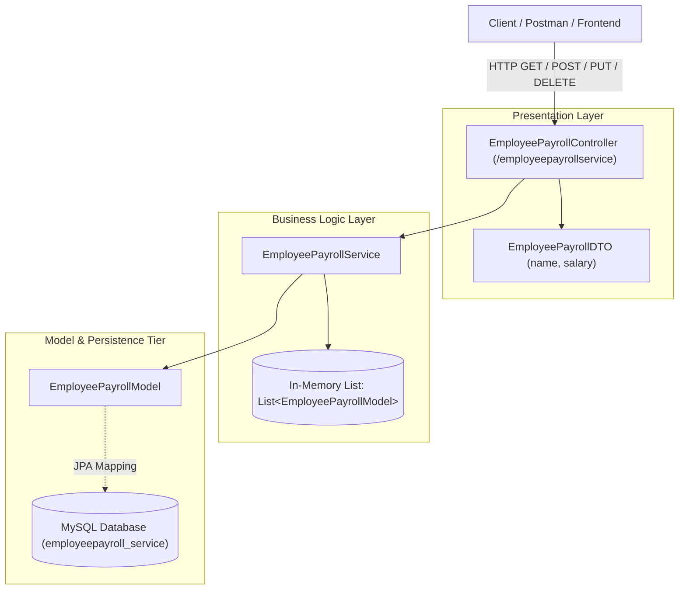
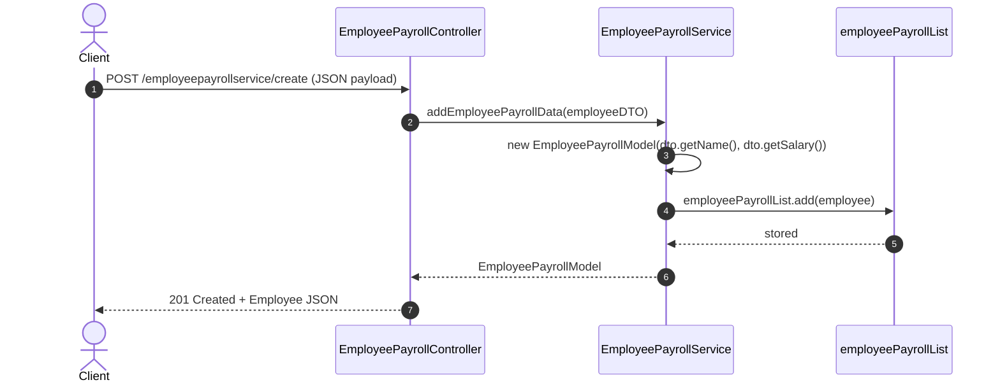

# Employee Payroll Service - Spring Boot REST API

An enterprise-ready backend REST API application built with Java, Spring Boot, Spring Web MVC, and Spring Data JPA. This project demonstrates clean layered architecture across Controller, Service, DTO, and Model layers, supporting full CRUD operations for employee payroll data.

The project follows the GitFlow branching strategy. The `main` branch serves exclusively as the production documentation branch containing the `.gitignore` and this comprehensive specification. The complete application source code resides on the `develop` branch and across dedicated feature branches merged via pull requests.

---

## 1. Project Overview

Managing workforce compensation records manually or through disparate spreadsheets introduces operational errors, calculation drift, data redundancy, and poor auditability. 

The Employee Payroll Service provides a centralized, lightweight RESTful web service for HR and payroll administrators to record, query, update, and manage employee compensation details. 

The application was developed incrementally across structured Use Cases (Section 1 and Section 2), transitioning from basic Spring Boot bootstrapping and generic HTTP controller mapping into a decoupled layered architecture featuring:
- Dedicated Data Transfer Objects (DTO) protecting internal representations.
- Domain Models encapsulating employee attributes (Name, Salary).
- A centralized Service Layer maintaining in-memory payroll records.
- Comprehensive REST endpoints handling full CRUD operations (GET, POST, PUT, DELETE).

---

## 2. Problem Statement & Motivation

Traditional monolithic and tightly-coupled payroll systems suffer from key software design weaknesses:
1. Tight Controller-Data Coupling: Directly embedding business and data manipulation logic inside web controllers, creating unmaintainable code.
2. Direct Entity Exposure: Exposing database schemas directly to API clients, creating security and compatibility risks.
3. Lack of Layered Separation: Mixing HTTP status handling, input translation, and data storage logic in single classes.

This application resolves these issues by applying clean architecture principles:
- The Controller layer manages HTTP serialization and routing.
- The Service layer encapsulates all business logic and collection manipulation.
- DTOs define strict API contracts for client input.
- Domain Models isolate internal entity representations.

---

## 3. Technology Stack

| Category | Technology | Purpose |
| :--- | :--- | :--- |
| Programming Language | Java 21 LTS | Core language leveraging modern LTS features and type safety |
| Framework | Spring Boot 4.1.2 | Application auto-configuration and embedded Tomcat server |
| Web Layer | Spring Web MVC | RESTful API controllers and HTTP request/response dispatching |
| Validation | Jakarta Bean Validation | Declarative validation constraints on incoming payloads |
| Persistence / ORM | Spring Data JPA / Hibernate | Relational persistence abstractions and database mapping |
| Database | MySQL 8.0+ | Relational data storage for payroll records |
| Driver | MySQL Connector/J | JDBC database driver |
| Developer Tools | Spring Boot DevTools | Fast application restart and live reload during development |
| Build Tool | Apache Maven 3.9+ | Dependency resolution, compilation, packaging, and test runner |
| Testing | JUnit 5 & MockMvc | Automated unit and web-tier integration testing |

---

## 4. Architecture and Request Flow

The application enforces strict separation of concerns across four distinct tiers:



### Request Lifecycle Example (POST /create)



---

## 5. Use Case Evolution Roadmap

Development progressed incrementally across two major sections:

### Section 1: Setup and Basic Controller
* `Section1-UC1-Setup`: Initialized the Spring Boot application structure with Maven configuration and base test suite.
* `Section1-UC2-RestController`: Implemented `EmployeePayrollController` with basic HTTP methods (`GET`, `POST`, `PUT`, `DELETE`) verifying client-server communication using generic responses.

### Section 2: Layered Architecture, DTO, and Service
* `Section2-UC1-DTO`: Introduced `EmployeePayrollDTO` and `EmployeePayrollModel` to decouple API contracts from internal representations.
* `Section2-UC2-ServiceLayer`: Extracted all business logic out of the controller into a dedicated `EmployeePayrollService`, adhering to the Single Responsibility Principle.
* `Section2-UC3-MemoryInList`: Implemented full in-memory list operations (`ArrayList<EmployeePayrollModel>`) supporting dynamic addition, 1-based index retrieval, updates, and deletion with error messages.

---

## 6. Complete Directory Structure

```text
EmployeePayrollService/
|-- .gitattributes
|-- .gitignore
|-- mvnw
|-- mvnw.cmd
|-- pom.xml
|-- README.md
|-- .mvn/
|   `-- wrapper/
|       `-- maven-wrapper.properties
`-- src/
    |-- main/
    |   |-- java/
    |   |   `-- com/
    |   |       `-- bridgelabz/
    |   |           `-- employeepayrollapp/
    |   |               |-- EmployeePayrollAppApplication.java
    |   |               |-- controller/
    |   |               |   `-- EmployeePayrollController.java
    |   |               |-- dto/
    |   |               |   `-- EmployeePayrollDTO.java
    |   |               |-- model/
    |   |               |   `-- EmployeePayrollModel.java
    |   |               `-- service/
    |   |                   `-- EmployeePayrollService.java
    |   `-- resources/
    |       `-- application.properties
    `-- test/
        `-- java/
            `-- com/
                `-- bridgelabz/
                    `-- employeepayrollapp/
                        |-- EmployeePayrollAppApplicationTests.java
                        |-- controller/
                        |   `-- EmployeePayrollControllerTest.java
                        |-- dto/
                        |   `-- EmployeePayrollDTOTest.java
                        |-- model/
                        |   `-- EmployeePayrollModelTest.java
                        `-- service/
                            `-- EmployeePayrollServiceTest.java
```

---

## 7. REST API Documentation

Base URL: `http://localhost:8080/employeepayrollservice`

### 1. Retrieve All Employees
* Method: `GET`
* Endpoint: `/employeepayrollservice/`
* Description: Fetches all employee payroll records stored in memory.
* Response: `200 OK`
```json
[
  {
    "name": "Ashish Srivastava",
    "salary": 65000.0
  }
]
```

### 2. Retrieve Employee by ID
* Method: `GET`
* Endpoint: `/employeepayrollservice/get/{id}`
* Description: Fetches a single employee record by 1-based position identifier.
* Path Variable: `id` (integer)
* Response: `200 OK` (or `404 Not Found` if index out of range)
```json
{
  "name": "Ashish Srivastava",
  "salary": 65000.0
}
```

### 3. Create New Employee Record
* Method: `POST`
* Endpoint: `/employeepayrollservice/create`
* Headers: `Content-Type: application/json`
* Request Body:
```json
{
  "name": "Rahul Verma",
  "salary": 55000.0
}
```
* Response: `201 Created`
```json
{
  "name": "Rahul Verma",
  "salary": 55000.0
}
```

### 4. Update Employee Record
* Method: `PUT`
* Endpoint: `/employeepayrollservice/update`
* Headers: `Content-Type: application/json`
* Request Body:
```json
{
  "name": "Rahul Verma",
  "salary": 58000.0
}
```
* Response: `200 OK` (or `404 Not Found` if storage is empty)

### 5. Delete Employee Record
* Method: `DELETE`
* Endpoint: `/employeepayrollservice/delete/{id}`
* Path Variable: `id` (integer)
* Response: `200 OK`
```json
{
  "message": "Employee deleted successfully",
  "id": 1
}
```

---

## 8. Installation and Execution

### Prerequisites
- Java Development Kit (JDK): Version 21 LTS or compatible.
- MySQL Server: Version 8.0+ running on port 3306.
- Git: Version 2.30+.
- Apache Maven (or use the provided Maven Wrapper `./mvnw.cmd`).

### Database Setup
1. Log in to MySQL and initialize the database schema:
```sql
CREATE DATABASE IF NOT EXISTS employeepayroll_service;
```

2. Configure connection credentials in `src/main/resources/application.properties`:
```properties
spring.datasource.url=jdbc:mysql://localhost:3306/employeepayroll_service
spring.datasource.username=root
spring.datasource.password=your_mysql_password
```

### Build and Test
```powershell
# Compile the application
.\mvnw.cmd clean compile

# Execute test suite
.\mvnw.cmd test
```

### Run Application
```powershell
# Start Spring Boot server
.\mvnw.cmd spring-boot:run
```
The application initializes on port `8080`.

---

## 9. Author Information

Ashish Srivastava  
GitHub: https://github.com/ashishsrivastava1712  
Email: isroasaws@gmail.com  
Repository: https://github.com/ashishsrivastava1712/EmployeePayrollService
